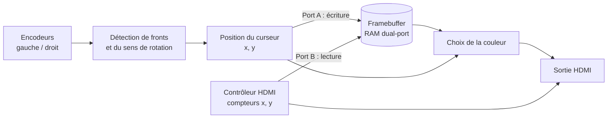

# Digital Etch A Sketch
 
Version numérique d'un **Télécran** (Etch A Sketch) en **VHDL**, réalisée sur une carte **Terasic DE10-Nano** (Intel Cyclone V) avec sortie **HDMI**. Le curseur est déplacé à l'aide de deux encodeurs rotatifs, comme sur le jouet original.
 
> Projet réalisé dans le cadre des TP FPGA à l'**ENSEA** (2ᵉ année), en binôme avec Yanis Grave.


## Fonctionnalités
 
- Déplacement du curseur avec **deux encodeurs rotatifs** (axe X et axe Y)
- Affichage en **HDMI** via un contrôleur vidéo
- **Mémorisation du tracé** dans un framebuffer (RAM dual-port)
- **Effacement** de l'écran par appui sur le bouton de l'encodeur gauche
- **Mode stylet levé / posé** par appui sur le bouton de l'encodeur droit

## Matériel et outils
 
| Élément | Détail |
| :--- | :--- |
| Carte | Terasic DE10-Nano |
| FPGA | Intel Cyclone V `5CSEBA6U23I7` |
| Carte mezzanine | Télécran (2 encodeurs, 10 LEDs, accéléromètre ADXL345) |
| Langage | VHDL |
| Synthèse | Intel Quartus Prime Lite 24.1 |
| Simulation | ModelSim |

## Architecture
 


## Détail des blocs
 
### 1. Gestion des encodeurs
 
Un encodeur incrémental délivre deux signaux **A** et **B** en quadrature. Le sens de rotation est déterminé à chaque front montant de A :
 
- **B = 0** → incrémentation
- **B = 1** → décrémentation
Les fronts sont détectés avec deux bascules D en cascade (état courant et état précédent du signal) et une porte logique :
 
```vhdl
e <= q1 and (not q2);  -- front montant
```
 
Le sens de rotation est ensuite géré par une machine à états de type Moore (`Attente` → `Détection A↑` → `inc` / `dec`).

### 2. Contrôleur HDMI
 
Le contrôleur génère les signaux de synchronisation (`HS`, `VS`, `DE`) attendus par le transmetteur HDMI **ADV7513**, ainsi que les compteurs `x` et `y` du pixel courant. Il est cadencé à **27 MHz** par une Boucle à Verouillage de Phase.
 
Le bus de données pixel est au format RGB sur 24 bits.
 
| Bits | Couleur |
| :---: | :--- |
| 23 – 16 | Rouge |
| 15 – 8 | Vert |
| 7 – 0 | Bleu |
 
### 3. Mémorisation du tracé
 
Les pixels parcourus sont stockés dans un **framebuffer** (RAM **dual-port** de `h_res × v_res` mots de 8 bits).
 
- **Port A** → écriture du pixel à la position du curseur
- **Port B** → lecture par le contrôleur HDMI pour l'affichage
```vhdl
s_addr_a <= s_pos_x + (s_pos_y * h_res);
```
 
Un pixel tracé vaut `x"01"`, un pixel vierge `x"00"` (8 bits suffisent, au lieu des 24 bits de la couleur).
 
### 4. Rendu
 
| Élément | Couleur |
| :--- | :---: |
| Curseur | ⬛ Noir |
| Tracé | 🟥 Rouge |
| Fond | ⬜ Blanc |
 
```vhdl
o_hdmi_tx_d <= x"000000" when (s_x_counter = s_pos_x and s_y_counter = s_pos_y) else
               x"FF0000" when s_q_b /= x"00" else
               x"FFFFFF";
```
 
### 5. Effacement
 
L'appui sur le bouton de l'encodeur gauche déclenche une machine à états qui **parcourt toutes les adresses de la RAM** pour y écrire `x"00"`. Un multiplexeur permet le balayage d'effacement sur le port A pendant l'opération.
 
### 6. Mode stylet
 
Le bouton de l'encodeur droit inverse le signal `r_pen_down`, qui commande le *write enable* du port A (stylet posé = on dessine, stylet levé = on déplace le curseur sans laisser de trace).

## Auteurs
 
- **Mathis Bibens** — [@Mathou7](https://github.com/Mathou7)
- **Yanis Grave**
